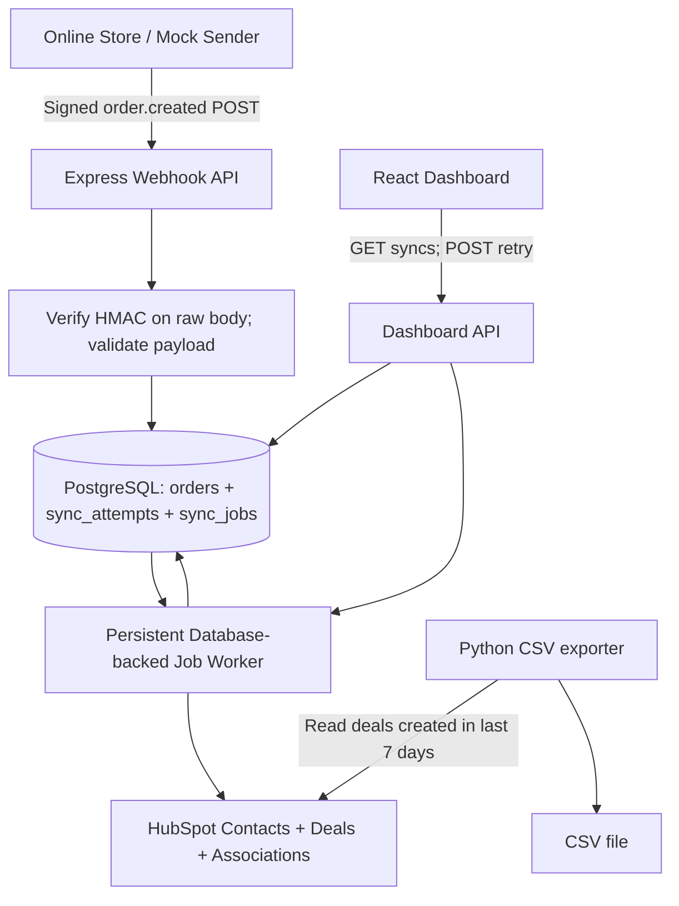

# GOAL.md — HubSpot Order Sync Integration

## Objective

Build a complete, reviewable take-home project that accepts signed online-store order webhooks, syncs each order to HubSpot as a Deal associated with the correct Contact, prevents duplicate Deals, records attempts, retries transient failures, and offers an operations dashboard. Add a separate Python program that exports deals created in the previous seven days to CSV.

**Primary goal:** Satisfy every Stage 2 core requirement (45 points) before pursuing bonuses (+5 points).

## Instructions to Codex

- Work through the phases in order. Keep the application runnable after each phase.
- Implement real working code; avoid simulated behavior in production paths. Use test doubles only in tests.
- Do not commit secrets, real personal information, access tokens, `.env`, local database data, or generated CSVs.
- Use environment variables for HubSpot access, webhook signing secret, pipeline ID, deal stage ID, and configuration.
- Prefer straightforward, maintainable code over unnecessary services or abstractions.
- Do not claim tests passed unless they were actually executed. Record blockers explicitly when credentials or external services are unavailable.
- Make retry behavior, idempotency, and partial-failure recovery especially robust.
- Keep a concise progress checklist updated below as each phase is completed.

## Required stack

| Layer | Technology |
|---|---|
| API/webhook receiver | Node.js, TypeScript, Express |
| Validation | Zod |
| Database | PostgreSQL + Prisma ORM + Prisma Migrate |
| HubSpot | Official CRM REST APIs (or supported SDK) |
| Dashboard | React, Vite, Tailwind CSS |
| Language B | Python 3 |
| Automated tests | Vitest, Supertest |
| Containerization | Docker Compose (PostgreSQL) |
| Optional workflow (bonus) | n8n exported workflow JSON |

Use compatible, supported versions; document the actual versions chosen. Check current HubSpot API requirements before locking endpoints and scopes. Do not assume a developer test account supports all features automatically; document how to create/configure the appropriate test account and authenticate the app.

## Given webhook payload

```json
{
  "event": "order.created",
  "order_id": "ORD-10482",
  "created_at": "2026-09-20T14:32:00+08:00",
  "customer": {
    "email": "maria.santos@example.com",
    "first_name": "Maria",
    "last_name": "Santos",
    "phone": "+639171234567"
  },
  "items": [
    {
      "sku": "TSH-BLK-M",
      "name": "Black Tee (M)",
      "qty": 2,
      "price": 450.00
    }
  ],
  "currency": "PHP",
  "total": 900.00
}
```

## High-level architecture



### Backend layer responsibilities

The Express API follows a Laravel-inspired MVC and service/repository structure:

- `routes/` maps HTTP methods and paths to controllers.
- `controllers/` stay thin: translate HTTP input/output and delegate use-cases.
- `services/` own business rules, transactions, orchestration, and retry decisions.
- `repositories/` are the only layer that performs Prisma/PostgreSQL data access.
- `middleware/` contains cross-cutting HTTP concerns such as raw-body parsing, authentication, and safe error responses.
- `validators/` holds Zod schemas and validation helpers.
- `jobs/` contains the persistent database-backed HubSpot worker. It leases and processes `sync_jobs`; it never relies on in-memory queues for durable work.
- `config/` owns validated environment configuration and infrastructure wiring.

### Core design rules

1. **Webhook security:** use the **raw request body** to calculate `HMAC-SHA256` with a shared secret. Require a header such as `X-Webhook-Signature: sha256=<hex_digest>`. Compare safely using a constant-time comparison; reject missing or malformed signatures with 401. The mock sender must produce exactly the same signature convention. Validate `order.created` and payload shape only after signature verification. Limit request body size.
2. **Acknowledgment:** persist a valid order transactionally before returning `202 Accepted`. Do not wait for HubSpot operations in the request handler. Invalid input returns 400; invalid signature returns 401; unexpected persistence failure returns 5xx.
3. **Idempotency:** enforce a unique constraint on `orders.order_id` and prevent concurrent deliveries/retries from claiming the same order. Also configure a **unique custom HubSpot Deal property** named `external_order_id` and use it as the CRM idempotency key. Reconcile an existing Deal on retry rather than creating another. Handle ambiguous HubSpot timeouts and duplicate-key responses safely.
4. **Partial-failure recovery:** preserve known HubSpot Contact/Deal IDs. If Deal creation succeeds but association fails, retry only what is necessary. If a HubSpot request succeeds but its response is lost, look up `external_order_id` before creating a new Deal.
5. **Retry policy:** retry HubSpot HTTP `429` and transient `5xx`, plus retryable network errors, with capped exponential backoff and jitter. Respect `Retry-After` when supplied. Cap attempts, record errors, and make exhausted attempts available for manual retry. Do **not** automatically retry arbitrary 4xx errors.
6. **Processing durability:** pending/retryable jobs must survive process restarts. Use database-backed statuses, `next_retry_at`, and a lease/claim strategy for a single or multiple worker processes. Cleanly recover expired processing leases.
7. **Observability:** record every processing attempt (not only the latest order state), with status, error, timestamps, HubSpot IDs, and attempt number. Avoid logging tokens, secrets, or full sensitive payloads.
8. **HubSpot configuration:** configure pipeline and stage using their internal IDs. Convert timestamps to the required API formats. Verify how account currency and PHP amounts are handled; document assumptions. Use only necessary HubSpot scopes.
9. **Dashboard security:** no HubSpot credentials in the browser. Restrict access to dashboard/API endpoints for deployed use; for a local demo, document a safe authentication strategy and secure defaults. Do not expose stack traces or sensitive customer data in error responses.

## Data model

### `orders`

- `id`: UUID / CUID primary key
- `order_id`: required string, **unique**
- `payload`: JSON serialized as text (raw validated order data)
- `status`: `PENDING | PROCESSING | SUCCESS | FAILED`
- `hubspot_contact_id`: nullable string
- `hubspot_deal_id`: nullable string
- `next_retry_at`: nullable timestamp
- `processing_lease_until`: nullable timestamp
- `created_at`, `updated_at`: timestamps

### `sync_attempts`

- `id`: UUID / CUID primary key
- `order_id`: relation/reference to `orders`
- `attempt_number`: integer
- `status`: `PROCESSING | SUCCESS | FAILED`
- `hubspot_contact_id`: nullable string
- `hubspot_deal_id`: nullable string
- `error_message`: nullable sanitized text
- `started_at`: timestamp
- `completed_at`: nullable timestamp

Add useful indexes on order status, next retry time, and attempt timestamps. Distinguish individual HTTP retries inside a processing attempt from an entirely new processing attempt; document this clearly.

### `sync_jobs`

- `id`: UUID / CUID primary key
- `order_id`: unique relation/reference to `orders`
- `status`: `PENDING | PROCESSING | COMPLETED | FAILED`
- `available_at`: timestamp for initial work or a scheduled retry
- `processing_lease_until`: nullable timestamp used to recover abandoned claims
- `attempts`, `max_attempts`: integers
- `last_error`: nullable sanitized text
- `created_at`, `updated_at`: timestamps

`sync_jobs` is the durable queue. The worker claims jobs atomically with a lease, while `sync_attempts` remains the audit trail for each processing run.

## HubSpot mapping

| Source | HubSpot destination |
|---|---|
| `customer.email` | Contact `email` (normalize for lookup) |
| `customer.first_name` | Contact `firstname` |
| `customer.last_name` | Contact `lastname` |
| `customer.phone` | Contact `phone` |
| `order_id` | Unique Deal `external_order_id` |
| `order_id` + customer | Deal `dealname`, e.g. `Order ORD-10482 - Maria Santos` |
| `total` | Deal `amount` |
| `currency` | Deal currency where supported/configured |
| env `HUBSPOT_PIPELINE_ID` | Deal `pipeline` |
| env `HUBSPOT_DEAL_STAGE_ID` | Deal `dealstage` |
| `created_at` | Deal `closedate` (document assumption) |
| resolved Contact ID | Deal-to-Contact association |

Search for the Contact by email, create if missing, or update if found. Search/upsert the Deal by unique `external_order_id` so retries and repeated webhook deliveries do not make duplicates. Make association creation idempotent. Do not fabricate HubSpot IDs in runtime logic.

## API contract

| Method | Endpoint | Behavior |
|---|---|---|
| POST | `/api/webhooks/orders` | Validate signature + payload; insert/reuse order; enqueue durable work; return 202 and order status |
| GET | `/api/syncs` | Last 50 sync attempts, newest first; optional status filter |
| GET | `/api/syncs/stats` | Counts by status for dashboard (define whether counts are orders or attempts) |
| GET | `/api/syncs/:id` | Attempt details, sanitized errors, HubSpot IDs |
| POST | `/api/orders/:orderId/retry` | Authorize, retry **only failed** order, atomically requeue; return updated state |
| GET | `/api/health` | Liveness/readiness as appropriate |

Avoid returning an entire persisted webhook payload in public list responses. Define error response structure consistently.

## Dashboard specification

A simple professional operations UI with:

- Summary cards: successful, failed, and pending orders, with clearly defined metric semantics.
- Last **50 sync attempts** ordered by timestamp, showing order ID, status, time, contact/deal IDs, and concise error state.
- Optional status filter.
- Error details for failed attempts.
- Real **Retry** button for failed orders; show pending/loading state, block double-clicks, display errors, and refresh data after retry.
- Empty states, loading skeletons, and accessible status labels.
- Responsive table/layout for mobile and desktop.

Do not implement a simulated retry button. The dashboard must call the real backend and display database-backed status.

## Python CSV exporter

File: `scripts/export_deals.py`

- Read HubSpot credentials and optional output location from environment/CLI.
- Fetch **all HubSpot Deals created in the trailing seven days**, using HubSpot's Deal **creation timestamp** (not close date), with correct pagination.
- Filter using consistent UTC boundaries and document whether the window is rolling seven days or seven calendar dates.
- Export CSV with at least Deal ID, Deal Name, Amount, Currency (when available), Create Date, Close Date, Pipeline, and Stage.
- Use an understandable filename such as `hubspot_deals_last_7_days.csv`.
- Handle pagination, authentication errors, rate limits, and network failures.
- Exit nonzero on failure; do not silently export an incomplete dataset.
- Use a real recent deal for acceptance testing. The sample payload's September 20, 2026 timestamp is older than seven days as of October 20, 2026, so it should not appear in a current seven-day export.
- The requirement says **all deals**, not just integration-owned deals: do not filter by `external_order_id` unless explaining and implementing an optional separate mode.

## Project structure

```text
hubspot-order-sync/
├── backend/
│   ├── src/
│   │   ├── app.ts
│   │   ├── server.ts
│   │   ├── config/
│   │   ├── routes/
│   │   ├── controllers/
│   │   ├── services/
│   │   ├── repositories/
│   │   ├── jobs/
│   │   ├── middleware/
│   │   ├── validators/
│   │   ├── utils/
│   │   └── tests/
│   ├── prisma/
│   │   ├── schema.prisma
│   │   └── migrations/
│   ├── prisma.config.ts
│   └── package.json
├── frontend/
│   ├── src/
│   │   ├── components/
│   │   ├── pages/
│   │   ├── services/
│   │   └── App.tsx
│   └── package.json
├── scripts/
│   ├── export_deals.py
│   ├── send_webhook.ts
│   └── requirements.txt
├── n8n/                      # optional bonus
│   ├── order-sync.json
│   └── error-notification.json
├── docker-compose.yml        # PostgreSQL for local development
├── .env.example
├── README.md
├── GOAL.md
└── .gitignore
```

The layout is a recommendation. Adjust only when it clearly simplifies implementation, and document major deviations.

## Phases and deliverables

### Phase 1 — Repository and infrastructure

- [x] Initialize backend TypeScript/Express project and frontend React/Vite/Tailwind project.
- [x] Set up Prisma ORM 7.10.1 with PostgreSQL, schema, migrations, and indexes.
- [x] Set up environment validation and `.env.example` (no real credentials).
- [x] Add scripts for installation, linting, tests, development, building, Prisma generation, and migration deployment.
- [x] Add Docker Compose PostgreSQL and implement `/api/health`; the dashboard calls it through the Vite API proxy.

**Acceptance:** fresh clone can install dependencies, start PostgreSQL, apply Prisma migrations, start frontend/backend, and call the health endpoint.

### Phase 2 — Secure webhook receiver and local idempotency

- [x] Implement strict `order.created` Zod schema with safe, clear validation errors.
- [x] Compute HMAC-SHA256 from original request bytes and verify with length-checked constant-time comparison.
- [x] Build a mock sender script that signs a fresh sample order and sends the webhook.
- [x] Persist a valid order and its initial `sync_jobs` row transactionally before HTTP acknowledgment.
- [x] Enforce unique `order_id` atomically and correctly handle simultaneous duplicate requests.
- [x] Test valid, invalid, unsigned, tampered, schema-invalid, duplicate, and concurrent duplicate delivery paths against PostgreSQL.

**Acceptance:** passed with PostgreSQL integration tests: signed valid requests get 202; missing/invalid/tampered signatures get 401; invalid payload gets 400; concurrent duplicate delivery creates one order and one queue entry.

### Phase 3 — HubSpot synchronization

- [x] Document HubSpot test account/auth setup, least-privilege scopes, current dated API paths, and configuration.
- [x] Verify/create the unique Deal property `external_order_id`, with documented manual setup when property-schema permission is unavailable.
- [x] Search/upsert Contact by normalized email.
- [x] Reconcile/create Deal using `external_order_id` and map required properties.
- [x] Create an idempotent default Deal-to-Contact association.
- [x] Save HubSpot IDs after each remote object resolves and mark job/order success after association.
- [x] Add mock-based client/service tests for mappings, property verification, associations, and idempotency recovery.

**Acceptance:** mock-based tests verify existing Contacts/Deals update, new records create, reconciliation uses the unique external ID, and the resulting Deal is associated to the resolved Contact. The worker uses PostgreSQL job claims; no real HubSpot credentials are used in tests.

### Phase 4 — Reliability, logs, and recovery

- [x] Add bounded 429/5xx/network retry with exponential backoff, full jitter, and capped `Retry-After` handling.
- [x] Store a `sync_attempts` record for every worker processing attempt, with IDs, status, error, and timestamps.
- [x] Persist partial Contact/Deal IDs and handle failures at Contact, Deal, and association steps.
- [x] Make processing jobs restart-safe through exact lease ownership, expired-lease recovery, and scheduled retry claiming.
- [x] Handle HubSpot success followed by a lost HTTP response without duplicates via persisted IDs and `external_order_id` reconciliation.
- [x] Add an opt-in PostgreSQL verification suite with mocked HubSpot 429/500/503/400 responses and no real HubSpot writes.
- [ ] Ensure failed orders can be manually requeued without racing an active worker. (Phase 5 API/dashboard work.)

**Acceptance:** transient failures recover through durable scheduled retries; exhausted/permanent failures have inspectable attempt history; interrupted and partially successful operations resume safely without duplicate Deals.

### Phase 5 — Dashboard

- [ ] Implement sync list/details/statistics endpoints and retry endpoint.
- [ ] Implement React dashboard with recent 50 attempts and status summaries.
- [ ] Display readable errors and available HubSpot IDs.
- [ ] Wire retry button to real authenticated API; loading/success/error states work.
- [ ] Validate UI against real PostgreSQL records and mock HubSpot failures.

**Acceptance:** a failed sync appears in the dashboard, retry queues a new attempt, and status changes after processing.

### Phase 6 — Python accounting export

- [ ] Implement real HubSpot Deal fetch with seven-day creation-date filter.
- [ ] Handle pagination and 429/5xx retry.
- [ ] Write a valid UTF-8 CSV with headers and required Deal fields.
- [ ] Add runnable CLI examples and an empty-result behavior.
- [ ] Test date filtering and pagination with mocked responses.

**Acceptance:** with credentials, running the Python script exports all matching deals; when no deals match, it writes a header-only CSV.

### Phase 7 — Tests, documentation, and submission

- [ ] Add automated tests for mapping, HMAC, idempotency (including concurrency), retries, and partial-failure recovery.
- [x] Add Docker Compose with a persistent PostgreSQL volume.
- [ ] If time permits, create n8n workflow JSON for webhook validation/contact/deal sync plus a separate error notification workflow (bonus). Document import, credentials, secrets, and any non-parity limitations.
- [ ] Write comprehensive `README.md`: prerequisites, installation, env variables, HubSpot setup, run commands, architecture, assumptions, tradeoffs, tests, screenshots or demo steps, and improvements with more time.
- [ ] Verify gitignore, no secrets, clean lint/build/test output, and reproducible fresh setup.
- [ ] Provide exact sample commands for sending the signed webhook and exporting CSV.

**Acceptance:** another developer can clone, configure, run, validate a complete sync, inspect failures, retry, and generate an export by following README alone.

## Test matrix

- [x] Correct signed request accepted
- [x] Missing/invalid/tampered HMAC rejected
- [x] Invalid schema rejected
- [x] Duplicate deliveries do not duplicate local orders or jobs
- [x] Two concurrent identical deliveries produce only one sync job
- [x] Existing Contact updated; new Contact created
- [x] Deal has expected name, amount, configured stage, pipeline, currency, and close date
- [x] Contact–Deal association is created idempotently
- [x] 429 and 5xx trigger bounded retries with Retry-After support
- [x] Non-retryable 4xx is logged and persisted as a permanent failure
- [x] Deal creation succeeded but response was lost: recovery uses external ID
- [x] Association failure preserves IDs so retry does not recreate Deal
- [x] Sync records contain attempt history, HubSpot IDs, errors, timestamps
- [ ] Dashboard shows the 50 most recent attempts
- [ ] Manual retry of failed order works and blocks duplicate claims
- [x] Expired processing jobs survive worker restart through safe lease recovery
- [x] Development-only PostgreSQL verification demonstrates retry scheduling, exhaustion, attempt history, and lease recovery
- [ ] Python CSV uses create date, covers entire window, paginates, and includes headers
- [ ] README is executable on fresh clone

## Completion definition

The project is done only when all eight core requirements are implemented, tests pass, setup instructions are complete, and the repo is ready for GitHub submission. Missing HubSpot credentials may block a real-account integration test; in that case, report the blocker truthfully and include mocked automated tests rather than claiming external verification.

## Potential improvements with more time

- Dedicated external queue and dead-letter queue if the PostgreSQL-backed worker no longer meets throughput needs.
- OAuth and multi-tenant account connection instead of single-account token configuration.
- Request timestamp/replay window and signature key rotation (requires agreement on sender signature format).
- Expanded telemetry, tracing, alerting, and retention controls.
- RBAC/SSO for dashboard users.
- More complete product/line-item synchronization and store-defined stage mapping.

## Final submission checklist

- [ ] GitHub repository link is available and permissions verified.
- [ ] `.env.example` and README enable local setup.
- [ ] TypeScript webhook, HubSpot sync, idempotency, retry, PostgreSQL history, and dashboard fully working.
- [ ] Python export script fully working.
- [ ] Tests and Docker Compose included if implemented.
- [ ] n8n JSONs included if attempted.
- [ ] No secrets, generated databases, or sensitive customer data committed.
