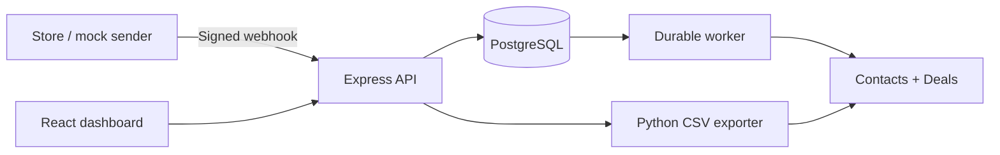

# HubSpot Order Sync

A take-home integration project for Optima Solutions. It receives signed order
webhooks, creates or updates HubSpot Contacts and Deals, records sync history,
and provides a monitoring dashboard and CSV export.

## Stack

- Node.js, TypeScript, Express, Zod
- PostgreSQL, Prisma 7, Docker Compose
- React, Vite, Tailwind CSS
- Python 3.11+ CSV exporter
- Optional n8n workflow bonus

## Quick start

Requires Node.js 20.19+ (or 22.12+), npm 10+, Docker Compose, and Python
3.11+ for the CSV exporter.

```bash
git clone https://github.com/carlcarreon/hubspot-integration.git
cd hubspot-integration
cp .env.example .env
npm install
docker compose up -d postgres
npm run db:migrate:deploy
npm run db:generate
```

Set the required values in the uncommitted `.env`, then start the app:

```bash
# Terminal 1: API + dashboard
npm run dev

# Terminal 2: durable HubSpot worker
npm run worker
```

- Dashboard: `http://localhost:5173`
- API: `http://localhost:3000`
- Health check: `curl http://localhost:3000/api/health`

Stop PostgreSQL without deleting data:

```bash
docker compose down
```

## Optional full-stack Docker demo

With a configured, uncommitted `.env`:

```bash
docker compose --profile full up --build
```

This starts PostgreSQL, migrations, API, worker, and dashboard. It is for local
review only; production needs HTTPS, SSO/RBAC, and managed secrets.

## Environment

Copy `.env.example`; never commit `.env`.

| Variable | Purpose |
| --- | --- |
| `DATABASE_URL` | PostgreSQL connection string |
| `WEBHOOK_SIGNING_SECRET` | HMAC-SHA256 secret for order webhooks |
| `HUBSPOT_ACCESS_TOKEN` | Server-only HubSpot private-app token |
| `HUBSPOT_PIPELINE_ID` | HubSpot Deal pipeline internal ID |
| `HUBSPOT_DEAL_STAGE_ID` | HubSpot Deal stage internal ID |
| `DASHBOARD_API_TOKEN` | Dashboard API bearer token |
| `PYTHON_EXECUTABLE` | Optional Python 3.11+ path for CSV export |

The browser never receives `HUBSPOT_ACCESS_TOKEN`.

## Architecture



The backend follows a Laravel-inspired structure:

```text
routes/        HTTP routes
controllers/   Thin request/response handlers
services/      Business rules and orchestration
repositories/  Prisma/PostgreSQL access
middleware/    HMAC, auth, and error handling
validators/    Zod schemas
jobs/          Lease-based durable sync worker
```

## How it works

1. `POST /api/webhooks/orders` verifies raw-body HMAC-SHA256 before parsing.
2. A valid order and one `sync_job` are stored in one transaction.
3. PostgreSQL unique `order_id` prevents duplicate local orders/jobs.
4. The worker searches or updates the Contact by normalized email.
5. It searches or updates the Deal by unique `external_order_id`.
6. It associates the Deal with the Contact and records each sync attempt.

The worker retries HubSpot `429`, `5xx`, and network failures with bounded
backoff, jitter, and `Retry-After` support. Permanent `4xx` errors are stored
as failed jobs. Expired worker leases are recovered safely.

## HubSpot setup

Use a HubSpot private app with:

- `crm.objects.contacts.read`, `crm.objects.contacts.write`
- `crm.objects.deals.read`, `crm.objects.deals.write`
- `crm.schemas.deals.read`, `crm.schemas.deals.write`

Create or allow the app to create this unique Deal property:

```text
Label: External Order ID
Name: external_order_id
Type: Single-line text
Unique values: enabled
```

`created_at` is mapped to Deal `closedate`. The HubSpot account must support
the incoming currency, such as `PHP`.

## Demo

Send an assessment-compatible signed webhook:

```bash
npm run webhook:send
```

Expected response: `202 Accepted`. The worker then creates or updates the
Contact and Deal. Open the dashboard, refresh, and inspect Orders or the
latest 50 real sync attempts.

For a terminal failed order, use **Retry**. The protected API requeues it
atomically; the existing worker processes it. Existing HubSpot IDs and attempt
history are retained.

## Dashboard

The dashboard shows current order status, HubSpot IDs, errors, attempt history,
and retry controls. It supports server-side status filtering, search,
pagination, URL state, refresh, and CSV download.

| Endpoint | Purpose |
| --- | --- |
| `GET /api/orders` | Current orders with server-side filters/pagination |
| `GET /api/orders/:orderId/attempts` | Stored attempt history for one order |
| `GET /api/syncs` | Latest 50 real sync attempts |
| `GET /api/syncs/stats` | Successful, failed, pending, processing counts |
| `POST /api/orders/:orderId/retry` | Atomically requeue a terminal failed order |
| `GET /api/exports/deals?days=7` | Download HubSpot Deals CSV |

Dashboard APIs require `DASHBOARD_API_TOKEN`. Search text can contain an email,
so avoid sharing dashboard URLs containing `q`.

## CSV export

The Python exporter is read-only and independent of the app:

```bash
python3.11 scripts/export_deals.py
python3.11 scripts/export_deals.py --output exports/deals.csv --days 14
```

It exports all Deals created in a rolling UTC date window. It follows HubSpot
pagination, preserves monetary strings, handles empty properties, and retries
temporary `429`/`5xx` failures. Output columns are:

```text
Deal ID, External Order ID, Deal Name, Amount, Currency, Pipeline ID,
Deal Stage ID, Close Date, Created Date
```

## Optional n8n bonus

[`n8n/order-to-hubspot.json`](n8n/order-to-hubspot.json) is an independent
n8n workflow. It verifies raw-body HMAC, validates the order, synchronizes the
Contact/Deal, and associates the records. Its error workflow sends sanitized
SMTP alerts.

Verified n8n results:

- Invalid HMAC → `401`
- Valid HMAC + invalid payload → `400`
- Valid order → `200`, Deal creation, Contact association
- Sequential duplicate order → same Deal ID
- Automatic failure → SMTP alert

The exports are sanitized: no secrets, credential IDs, workflow IDs, instance
metadata, or execution data. After import, bind credentials and select the
Error Workflow again in the main workflow settings. Both Deal write nodes use
`pipeline: default` and `dealstage: appointmentscheduled`.

Sequential replay is verified. Concurrent first deliveries can still race in
n8n; use the Express/PostgreSQL worker for production-grade idempotency and
retries. See [n8n/README.md](n8n/README.md) for setup details.

## Checks

```bash
npm run lint
npm test
npm run build
python3.11 -m unittest discover -s scripts/tests -t . -v

# Optional PostgreSQL reliability suite; stop the worker first
npm run test:phase4:verify
```

The test suite makes no real HubSpot requests. The Phase 4 suite uses mocked
HubSpot responses and only cleans up its own verification rows.

## Requirements status

| Requirement | Status |
| --- | --- |
| Signed TypeScript webhook | Complete |
| HubSpot Contact/Deal sync | Complete |
| Idempotency | Complete in Express/PostgreSQL |
| Retry and failure logging | Complete |
| PostgreSQL sync history | Complete |
| React monitoring dashboard | Complete |
| Python Deal CSV export | Complete |
| Setup and documentation | Complete |
| Optional n8n workflow | Complete; see concurrency limitation above |

## Notes

- This is a single-account integration with one configured pipeline and stage.
- Production should use HTTPS, SSO/RBAC, a secret manager, monitoring, and a
  dedicated queue if throughput exceeds PostgreSQL-worker capacity.
- Do not reset the database or edit durable job rows to force a retry; use the
  dashboard Retry action.
